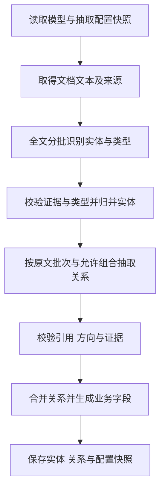

# Design

## Context

动机与功能范围见 `proposal.md`；用户可观察行为见两个 delta spec。

- `backend/app/pipeline.py` 在文档开始时确定模型与抽取配置快照，按章节或文本长度生成批次，保存独立的实体与关系集合。
- `backend/app/skill4re_client.py` 使用 `ConfiguredExtractor` 执行实体识别、归并和关系抽取。原文上下文在处理期间参与身份与类型校验。
- `extraction_schema.py` 分别维护模型输出与公开业务结果的结构校验；`ResultViewer.jsx` 直接读取实体与关系集合。
- 配置页面使用 `ExtractionSchemaManager.jsx` 和 `/api/settings/extraction-schema`。服务使用 Flask、Redis、Worker；界面使用 React、Vite 和 Arco Design。
- `PRODUCT.md` 定义可配置实体与关系范围、处理耗时目标和结果显示要求。
- 已有 `unify-llm-request-config` 与 SSE 变更中的文档模型快照、请求选项、事件续传继续适用；新流程的事件分组使用阶段和批次信息。

## Goals / Non-Goals

**Goals:**

- 通过同一份版本化定义约束提示词、输出 schema、引用校验、页面名称和导出。
- 在有界模型请求内覆盖全文实体与合法关系候选，处理期间保留必要原文上下文。
- 使实体归并和关系引用能够分别校验，并在处理错误时立即终止相应任务。

**Non-Goals:**

- 历史任务保持原始数据；补充实体类型需要重新提交文档。

## Decisions

### 1. 一份版本化配置保存类型和关系

新增 `backend/app/extraction_schema_store.py`，配置保存在 `STORAGE_ROOT/settings/extraction-schema.json`。基础结构如下：

| 对象 | 字段 |
| --- | --- |
| 配置 | `schema_version`、`revision`、`entity_types`、`relation_types` |
| 实体类型 | `id`、`name`、`description`、`parent_id`、`examples` |
| 关系类型 | `id`、`name`、`description`、`enabled`、`symmetric`、`allowed_pairs`、`examples` |
| 类型组合 | `head_type_id`、`tail_type_id` |

`schema_version=1` 表达配置文件格式；`revision` 为服务生成的递增整数，表达用户保存版本。ID 使用英文、数字和下划线，创建后保持不变；显示名称可修改。类型使用单一父类型，校验全部祖先引用与循环。关系允许多个明确组合，规则匹配时计算父类型的后代集合。

实体识别范围由启用关系两端引用的类型及全部后代类型求并集。配置中尚未被启用关系引用的类型保留在配置页面，暂不进入抽取范围。允许保存全部关系关闭的配置；开始任务时报告没有启用关系的错误。

关系示例保存原文、实体类型标注和预期关系；识别示例保存原文与类型依据。示例使用相同结构校验，并在提交配置时检查引用、方向及允许组合。示例数组允许为空，名称、定义和至少一个类型组合为必填项。

选择整组配置保存，可以在同一次更新中添加实体类型并配置关系引用。页面使用两个独立类型列表和逐行组合编辑，关系两端的条件保持明确。

### 2. 默认配置完整表达三种关系

| ID | 名称 | 父类型 |
| --- | --- | --- |
| `command_organization` | 指挥机构 | 空 |
| `forward_detachment` | 前出分队 | 空 |
| `weapon_platform` | 武器平台 | 空 |
| `reconnaissance_platform` | 侦查平台 | 空 |
| `surface_strike_force` | 水面打击力量 | `weapon_platform` |
| `subsurface_strike_force` | 水下打击力量 | `weapon_platform` |
| `air_strike_force` | 空中打击力量 | `weapon_platform` |
| `long_range_missile_strike_force` | 长导打击力量 | `weapon_platform` |

| 关系 ID | 名称 | 方向 | `allowed_pairs` |
| --- | --- | --- | --- |
| `command` | 指挥 | 有向 | 指挥机构→指挥机构；指挥机构→前出分队；指挥机构→武器平台 |
| `coordination` | 协同 | 对称 | 指挥机构↔指挥机构；武器平台↔武器平台 |
| `intelligence_support` | 情报保障 | 有向 | 侦查平台→指挥机构 |

默认定义要求原文明确描述指挥控制、相互协同或向指挥机构提供情报支持；共同出现、共同参与行动及类型匹配不能单独证明关系成立。各类型提供名称、功能描述及边界示例，四类打击力量沿用用户给定分类。实体保存原文支持的具体类型；只有父类型证据时保存父类型。

协同关系采用对称语义，是本次提案采用的设计决定。用户可在网页维护关系方向性。对称关系校验接受同一允许组合的两个方向，保存时按实体 ID 确定统一顺序。

### 3. 原子保存、冲突校验及不可变快照

提供 `GET /api/settings/extraction-schema` 和 `PUT /api/settings/extraction-schema`。PUT 接收完整配置及其 `revision`，成功返回新配置；无效输入返回 400，过期版本返回 409，错误内容包含字段路径。已有 `/api/skills` 及其子地址统一返回 410，并提供新入口信息。

使用 `filelock.FileLock` 对同一配置文件的初始化和保存加跨进程锁。在锁内读取当前版本、校验提交版本、写入同目录临时文件并原子替换；临时文件明确位于 `settings/`。首次缺少文件时安装默认配置；损坏文件、权限错误和校验失败直接报告错误。读取方通过原子替换取得完整配置，不维护进程间可变缓存。

`DocumentPipeline.process_task()` 在 OCR 前同时取得模型快照与抽取配置快照。配置经过完整校验后转为不可变结构，显式传递给文档客户端及全部任务阶段。两个快照分别表达模型连接与抽取规则；运行期间不重新读取任一设置文件。结果保存抽取配置完整内容与版本，模型部分沿用已有公开摘要。

### 4. 结果以实体 ID 为引用基础

新结果顶层使用 `result_schema_version=4`，保存 `extraction_schema`、`entities`、`relations`、完整文档文本和运行摘要。

| 对象 | 字段 |
| --- | --- |
| 实体 | `entity_id`、`name`、`type_ids`、`aliases` |
| 别名 | `name` |
| 关系 | `relation_id`、`relation_type_id`、`head_id`、`tail_id` |

`type_ids` 支持同一对象具有多个经原文证明的角色类型。父类型继承在校验时计算，实体类型列表保留最具体的已知类型，不重复添加其祖先。

处理期间使用独立的原文引用结构保留跨句指代与身份上下文，`start`、`end` 使用 Unicode code point 左闭右开范围。相关引用只参与抽取、归并和模型输出校验。抽取服务在返回前通过 `public_graph()` 生成业务字段，后续结果保存、读取和导出使用独立的版本 4 schema 校验，无需原文引用字段。

模型返回批次局部 ID；服务按原文首次出现顺序分配文档实体 ID。归并实体和关系时同步替换 ID。实体 ID 在同一任务中稳定，不承诺不同任务使用相同 ID。模型的上下文引用使用请求内的来源编号，服务在处理中解析并校验；运行诊断单独保存。

实体名称支持并列共用后缀、排版换行和指代；实体识别提示要求在输出前检查名称、编号、所属和类型。

### 5. 实体识别、归并和关系抽取分别处理

在 `skill4re` 中新增配置驱动的抽取服务，复用已有 backend 与模型请求适配。`Skill4ReClient` 将文档快照绑定到该服务，网页处理直接使用配置中的类型与关系。实体识别提示词明确要求包括独立实体，并保留原文提及；关系提示词只使用快照中的启用定义。

实体阶段使用现有章节与 token 批次能力覆盖全文。记录每份输入在原文中的范围，重叠上下文只提供指代依据。原始 `document_text` 保持不变，身份识别通过实体 ID 和别名记录表达。

每批实体识别调用一次模型，提示要求输出前逐项检查名称、编号、所属、类型与实体完整性。返回结果立即执行结构、类型和来源校验，并进入实体归并。

实体身份判断按关联候选记录组织请求，在容量允许时合并多个独立候选集合，并使用文档并发设置执行。模型返回确认属于同一对象的实体分组，每组提供原文身份依据，每条记录最多属于一个分组。服务校验引用和分组互斥性后统一实体 ID，未确认身份的记录保持独立。名称相似或包含关系仅用于寻找候选，同名但所属、时间或身份不同的对象保持独立。

关系阶段在实体归并后执行，每份请求携带原文批次、允许的关系定义和全文紧凑实体登记表。登记表保存实体 ID、名称、类型和别名。名称或别名被多个实体共用，且本批次包含该名称、别名或相关原文提及时，相关实体附带身份来源编号及当前批次之外的身份来源正文，同一来源只传递一次。身份上下文用于区分所属与同名对象，关系证据的 schema 和程序校验均只允许当前批次来源；证据列表要求编号互不重复，数量最多等于可引用来源数。模型直接抽取本批次有证据的关系，并在输出前检查语义、方向和实体身份。服务执行完整程序校验后合并，独立实体始终保留。

关系业务输出保存 `relation_type_id`、`head_id`、`tail_id` 与记录 ID。请求 schema 按每条允许类型组合生成分支，分别限制该分支可用的头尾实体 ID，接受父类型的后代类型以及对称组合。处理期间的模型上下文引用仅允许本批次来源。

### 6. 请求容量通过有界分组处理

实体登记表能够放入请求时，每个原文批次执行一次关系抽取。请求通过类型规则表达可用的两端组合。超出容量时对头实体集合和尾实体集合进行有界分组，覆盖全部允许组合；对称重复在结果合并时统一去重。容量计算包括阶段提示、配置、实体登记表与原文。

将候选实体的定义来源与当前原文批次一起传入，处理前文全称和后文指代。附加证据超过容量时继续按来源单位分组，保留来源顺序和指代所需相邻上下文，直到每份请求满足限制。无法容纳单个必要输入单位或全部配置定义时，明确报告请求容量错误。

输入预算使用现有 token 估算规则，计算包含提示词、配置、实体信息与预留输出。服务端报告上下文不足时明确终止任务，并保存该请求的非敏感规模信息。不得静默截断输入。模型长度截断、无效 JSON 和校验失败直接报告阶段错误；传输重试沿用公共设置，不将格式失败改为另一种抽取流程。

`vllm` 关系请求使用 `temperature=0.2`。流式接收使用 `pydantic_core` 解析尚未完成的 JSON，每增加约 1024 个字符检查一次输出；同一证据列表中的来源编号，或同一条关系及相同证据，累计重复四次时终止请求并保存诊断内容，连续空白达到 1024 个字符时同样终止。关系比较忽略模型生成的记录 ID，允许同一关系引用不同证据。重复检测只用于报告生成异常，不将未完成的 JSON 作为完整结果保存。

在 `skill4re/skill4re/config.py` 集中维护实体识别、实体归并和关系抽取的输出上限，沿用 backend 的 thinking 配额规则。配置文件不另行设置模型连接。

### 7. 使用共同 schema 与显式语义校验

在 `skill4re` 的公共模块维护配置、模型阶段输出和最终结果的 JSON Schema，使用标准 `json` 读写和 `jsonschema` 校验。`jsonschema` 与 `filelock` 已列于 `skill4re/requirements.txt`，后端运行依赖需要直接声明实际导入的依赖。

远程模型请求使用共同字段定义构造 JSON Schema `response_format`，类型与关系 ID 枚举来自文档快照，空值使用可空类型。服务端解码 schema 采用其支持的约束，`uniqueItems` 与非空白字符串检查由本地完整 schema 校验；提示词和所有 backend 的返回校验保持完整约束。应用语义校验负责祖先类型、完整类型组合、ID 引用、方向与证据定位，任一错误提供任务、阶段、批次和字段路径。远程 SDK 消费服务端 SSE，任务事件通道仍使用已有回调。

关系规范化根据类型 ID、实体 ID 去重；对称关系使用排序后的两端 ID。校对、合并与任何后处理均通过同一套校验。独立实体集合单独维护，关系为空是正常结果。新流程不使用丢弃未知字段的五字段清洗函数。

### 8. 页面与导出按结果版本读取

用 `ExtractionSchemaManager.jsx` 提供“抽取配置”入口，分为“实体类型”和“关系类型”两个标签页。关系表单逐行维护头尾类型组合，类型选择同时显示父类型。配置修改保留本地草稿，显式保存整组配置；保存冲突保留输入并提供重新读取入口。字段错误显示在对应位置。

新结果直接读取 `entities` 和 `relations`，通过任务自身配置显示类型与关系名称。实体表显示实体名称与类型，别名显示于实体名称下方。关系表显示头实体、关系、尾实体及两端类型。保持页面滚动、现有列宽调整及任务切换行为。

原文准备完成后、实体抽取开始前，Worker 通过 `set_preview()` 保存任务专属原文，并设置 `preview_ready`。`GET /api/tasks/<task_id>/preview` 返回原文，尚未就绪返回 409，未知任务返回 404。PDF 与图片使用 OCR 和整理后的文本，Markdown 与 TXT 直接读取。预览与最终结果分别存储，前端按任务 ID 缓存预览，抽取期间与任务终止后均可查看已取得的原文。重新执行任务时清理旧预览及就绪标记。历史任务从已保存结果读取原文。

结果页面提供文档预览、实体、关系和运行日志四个标签页。预览保留搜索与缩放；实体与关系在完成抽取后显示结果。JSON 通过下载取得完整结果。

`GET /api/result/<task_id>/csv` 输出关系 ID、关系类型、头尾实体 ID、名称和类型；`/api/result/<task_id>/entities.csv` 输出全部实体的 ID、名称、类型和别名，每个实体一行。两种导出沿用标准 CSV 库、UTF-8 BOM 和公式注入保护。

版本 2 与版本 3 结果在读取时通过 `public_result()` 转换为版本 4，按共同业务字段读取实体与关系。没有 `result_schema_version` 的结果从已有关系容器提取业务字段，历史实体仅汇集关系两端；缺少类型显示“未标注”。显式为空的数组保持为空；不支持的版本或损坏的新格式直接报告结果格式错误。历史结果文件不重写。

### 9. 任务阶段、SSE 与失败状态

实体识别、实体归并、关系抽取均报告实际请求总数与完成数，任务进度随已完成请求更新。SSE 保留阶段、原文批次和请求组标识，前端显示中文阶段名称、批次或分组编号和已完成数量。历史 `merge-N-entity_merge` 显示为“实体归并 · 第 N 组”。事件序号、续传和任务隔离沿用现有机制，终止事件由整个任务的终态统一发出。

模型客户端、thinking、reasoning effort 和公共重试参数沿用文档模型快照。取消检查覆盖阶段入口、并发调度和模型返回后；取消后不调度后续阶段。任一结构或语义校验失败立即标记任务失败，已取得的原始输出仅作为诊断信息保存在专用目录，不发布成功结果。

### 10. 验证使用真实对象与真实服务

配置与规范化检查直接调用实际实现、真实 JSON 文件、schema validator 和 CSV 库。需要服务的检查启动隔离的真实 API、Worker、Redis，使用实际模型与 OCR。相关检查使用纯函数检查或真实集成检查，服务响应均来自实际服务。

验收覆盖默认三关系、合法与非法类型组合、四个武器平台子类型、独立实体、同名不同实体、跨批次指代、对称关系、空结果、配置并发保存、处理中更新、取消、SSE 和历史读取。关系与实体结果对照人工标注的原文样本核验。对用户提供的九页文档及对应 Markdown，目标耗时为 1—2 分钟，上限为 3 分钟；报告模型、并发、原文哈希、请求数、各阶段及全流程耗时，PDF 额外记录 OCR 耗时。

网页通过真实 DOM、键盘操作及下载内容核验，检查桌面与窄屏、保存冲突、任务切换和页面滚动。后端回归测试位于 `backend/tests/`，前端回归测试位于 `frontend/src/lib/`；执行相关测试、前端构建及 OpenSpec 严格校验。`scripts/` 保存启动命令。

## Risks / Trade-offs

- [全文实体登记表增加请求输入] → 使用紧凑登记表、按类型组合限制 ID 及有界并发，记录每阶段请求数、输入规模和耗时。
- [独立实体和具体类型存在识别错误或遗漏] → 提示词逐项检查列表与并列名称，使用带独立实体的人工标注样本验收；结构校验不替代语义质量核验。
- [跨批次归并误认同名对象] → 要求原文身份依据，保留同名不同对象，归并结论记录证据。
- [API 多进程同时保存配置] → 文件锁内校验版本并原子替换，过期提交返回冲突。
- [历史结果被当前配置改变解释] → 明确结果版本，历史读取保持原始数据，新结果使用保存的配置快照。

## Migration Plan

1. 增加共同 schema、默认定义、配置存储及直接依赖，完成真实文件读写与并发保存检查。
2. 接入文档配置快照与两阶段抽取服务，贯通实体、关系及原文来源校验，完成真实服务处理。
3. 同步部署匹配的 API、Worker 与前端，启用抽取配置管理、新格式结果和两类 CSV；旧 skills 接口返回 410。保留历史任务和已有模型设置文件。
4. 更新 `PRODUCT.md`、README、`backend/.env.example` 和 `docs/ICCT-RE 项目说明.md`，说明配置生效时间、类型组合和结果格式。停用网页流程专属的路由配置项，保留仍被独立运行入口使用的设置。
5. 完成多批次、配置更新、取消、浏览器和历史结果验收后提交相关文件。若需恢复部署版本，使用文件编辑恢复代码并配套恢复 API、Worker 和前端；配置与历史结果保留，版本 2 结果不交给只支持历史格式的读取程序。
